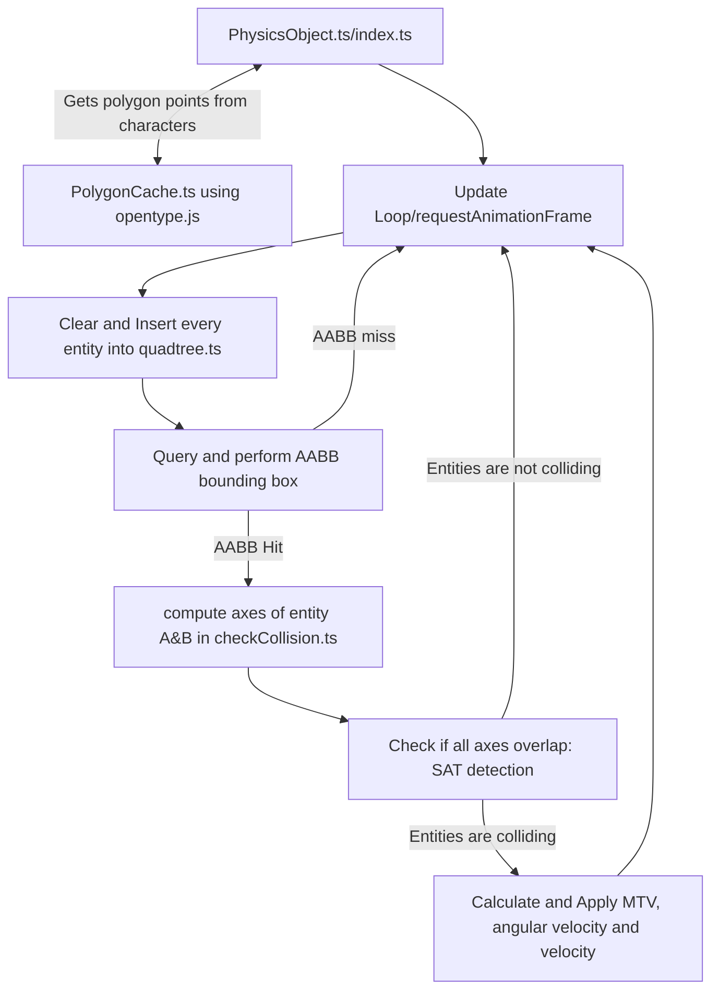

# [Physics-Banner](https://github.com/nickolasddiaz/Physics-Banner)

A rigid body physics simulation for ascii art, build using typescript and HTMLcanvas element. It uses one dependecy opentype.js for geting paths from a font.

- [Docs](https://nickolasddiaz.github.io/Physics-Banner/api)
- [Demo](https://nickolasddiaz.github.io/Physics-Banner/)

## How to Install

```bash
npm install @nickolasddiaz/physics-banner
```

## How to Use

```ts
import PhysicsBanner from "@nickolasddiaz/physics-banner";

physics_banner = new PhysicsBanner(yourHTMLCanvasElement, font_url(WOFF/OTF/TTF type font and not WOFF2), "black", font_size);
await physics_banner.setup();

const ascii_art = ... // multi-line string
physics_banner.spawn_string(ascii_art);
```

## File Structure

```bash
.
├── index.html                              # HTML for the demo
└── src                                     # Mono-repo for libary and demo
    ├── ascii_art.txt                       # Text file for the ascii art
    ├── demo.ts                             # Demo code using tweakpane
    └── lib                                 # Libary implementation
        ├── PhysicsObject
        │   ├── PhysicsObject.ts            # Class to manage the character body, handles updating and drawing characters
        │   └── checkCollision.ts           # Function to handle the SAT collision detection and response of the PhysicsObject.ts
        ├── collision
        │   ├── quadtree.ts                 # Used to efficiently query for PhysicsObjects and perform a bounding box test
        │   └── rectangle.ts                # Helper class for quadtree.ts to split quadrants
        ├── font
        │   └── PolygonCache.ts             # Stores convex hull polygon points using from opentype.js libary, offscreencanvas for drawing, and width/height for each character
        ├── geometry
        │   ├── point.ts                    # Extends vec2.ts to add an instance of PhysicsObject.ts used for the quadtree.ts
        │   └── vec2.ts                     # Class to represent a vector 2 with common operations
        └── index.ts                        # Exported class for the libary
```



## QuadTree Implementation

Adapted from the coding train, [quadtree.js](https://github.com/CodingTrain/QuadTree/blob/main/quadtree.js)

## SAT Theorem

Adapted from danielszabo88, [15 - Separating Axis Theorem](https://github.com/danielszabo88/mocorgo/blob/master/15%20-%20Separating%20Axis%20Theorem/script.js) and [dyn4j article](https://dyn4j.org/2010/01/sat/)
)

## Minimum Translation Vector

Adapted from danielszabo88, [16 - Minimum Translation Vector](https://github.com/danielszabo88/mocorgo/blob/master/16%20-%20Minimum%20Translation%20Vector/script.js)

## Rotational Collision

Adapted from danielszabo88, [14 - Rotational Collision](https://github.com/danielszabo88/mocorgo/blob/master/14%20-%20Rotational%20Collision/script.js) and [Dr. Nicolas Pronost](https://perso.liris.cnrs.fr/npronost/UUCourses/GamePhysics/lectures/lecture%207%20Collision%20Resolution.pdf)

## Convex Hull using Graham Scan Algorithm

Adapted from geeksforgeeks, [Convex Hull using Graham Scan](https://www.geeksforgeeks.org/dsa/convex-hull-using-graham-scan/)

## How to run the project

1. **Git clone the respository**

    ```bash
    git clone https://github.com/nickolasddiaz/Physics-Banner.git && cd Physics-Banner
    ```

2. **Development Server**

    ```bash
    npm run dev
    ```

3. **Build the libary**

    ```bash
    npm run build:lib
    ```

4. **Build the docs and demo**

    ```bash
    npm run build:demo
    ```

5. **Preview the demo**

    ```bash
    npm run preview
    ```
